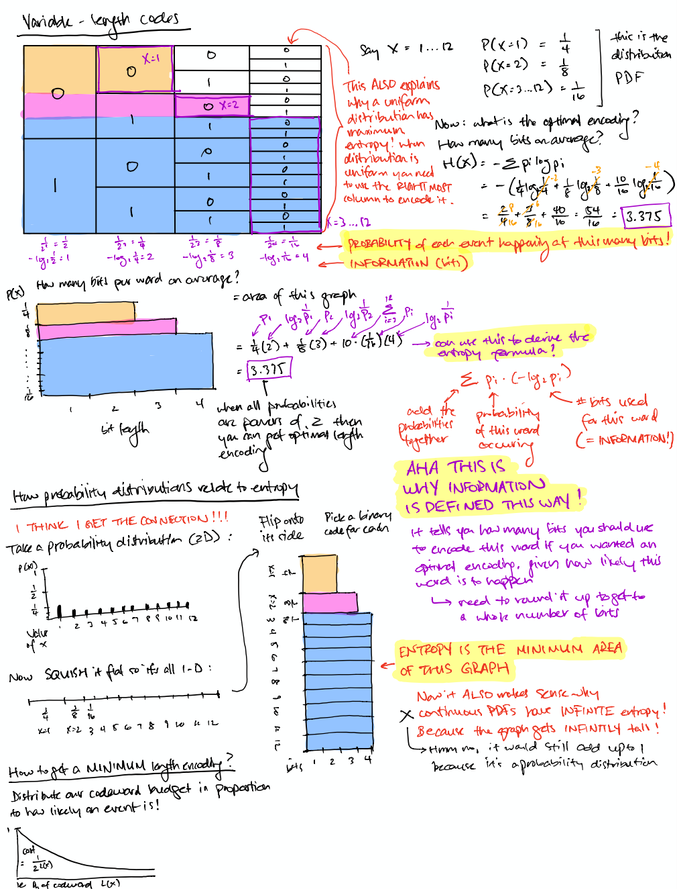
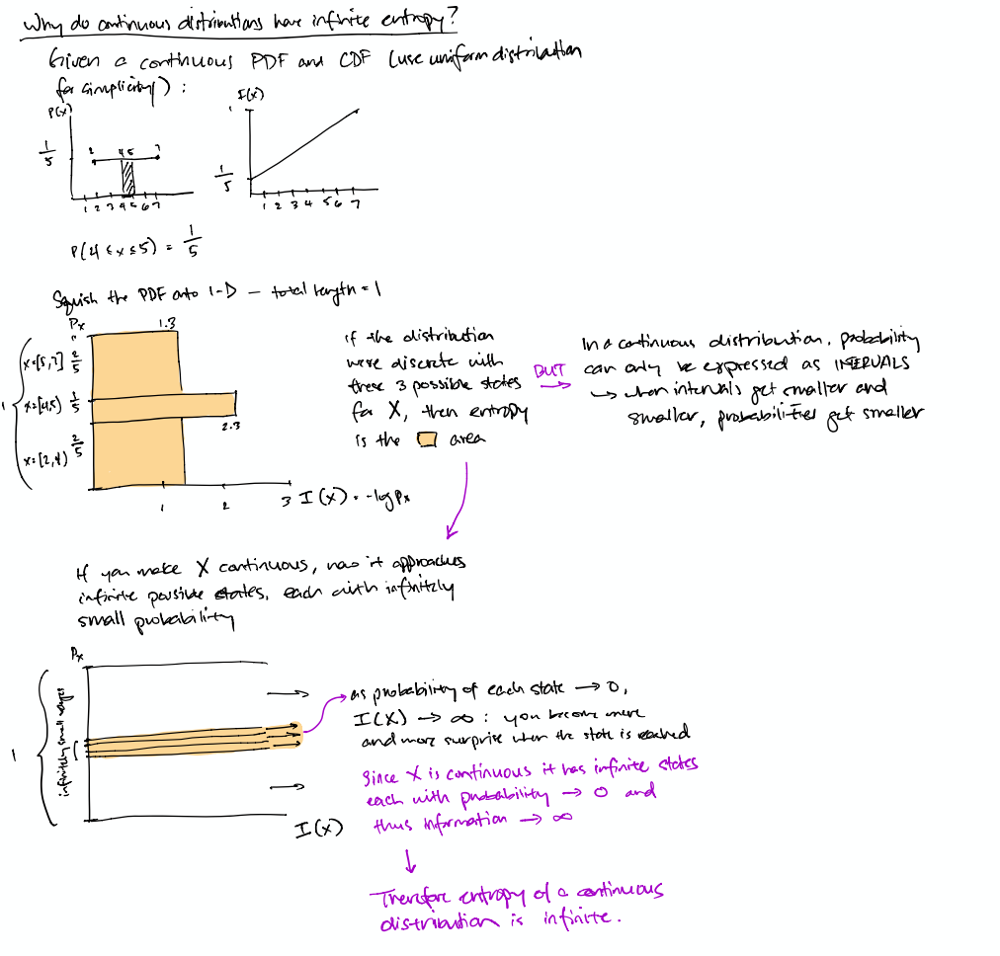
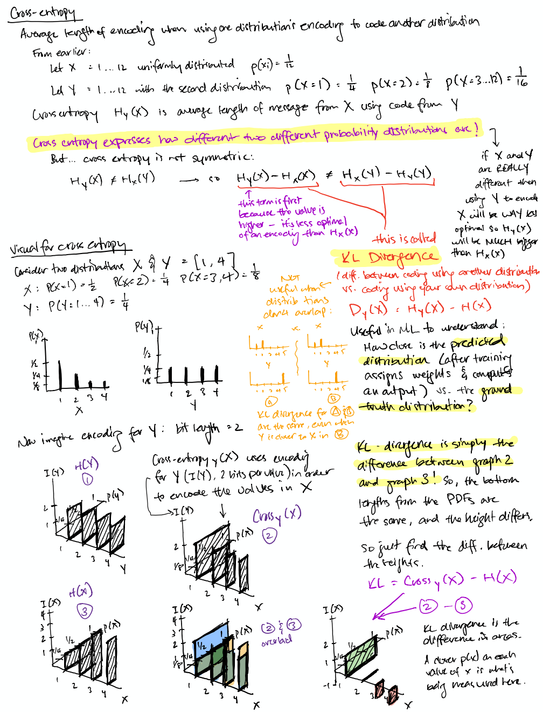
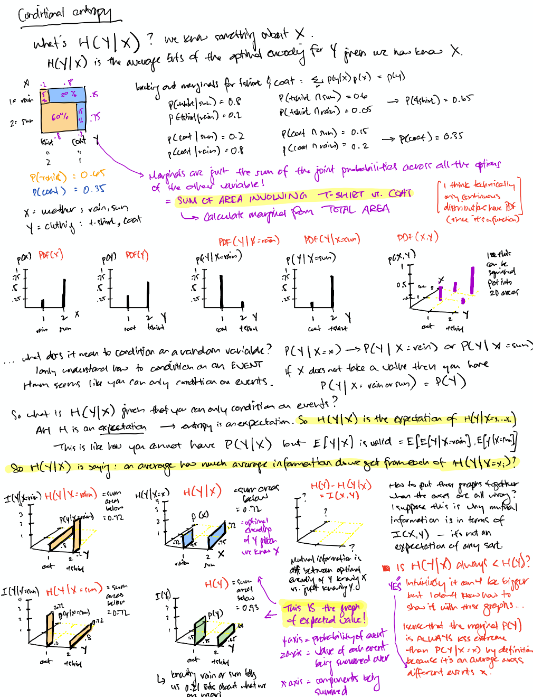
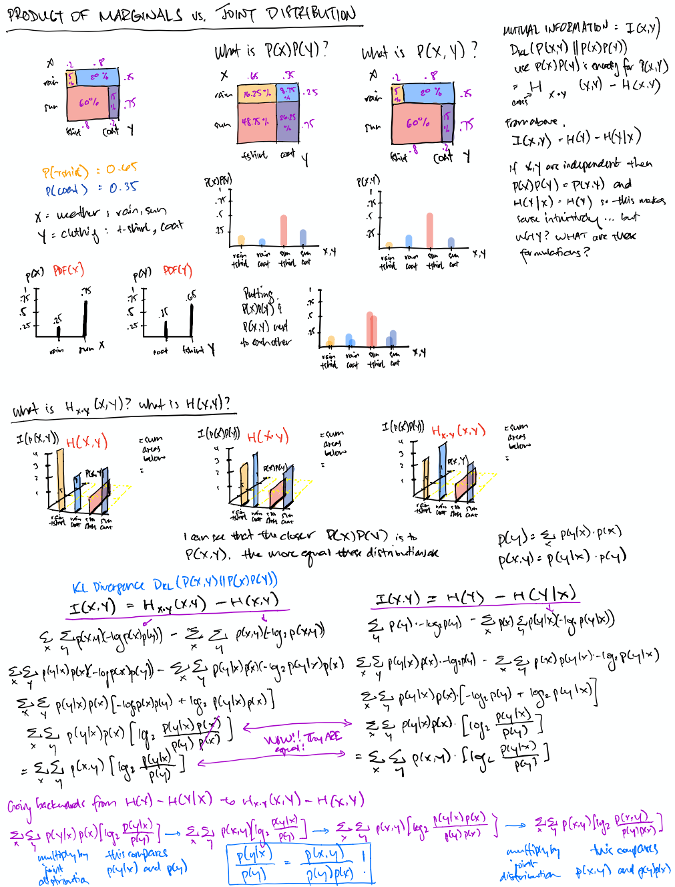

I draw visuals in order to understand concepts. Sometimes friends have found these helpful, so I thought I'd make them public.

These are raw notes from when I was learning each subject (sometimes many many years ago!), so they could be wrong! If you have a question about something, feel free to [ask](https://www.twitter.com/kanjun).

### How probability distributions relate to information & entropy

### Why continuous distributions have infinite entropy

### Cross-entropy

### Conditional entropy

### Independence

That moment when it clicks why KL divergence between P(X,Y) and P(X)P(Y) equals mutual information I(X,Y)! Thanks to [Chris Olah](https://colah.github.io/) for the rain/sun coat/no coat joint distribution example shown here.

